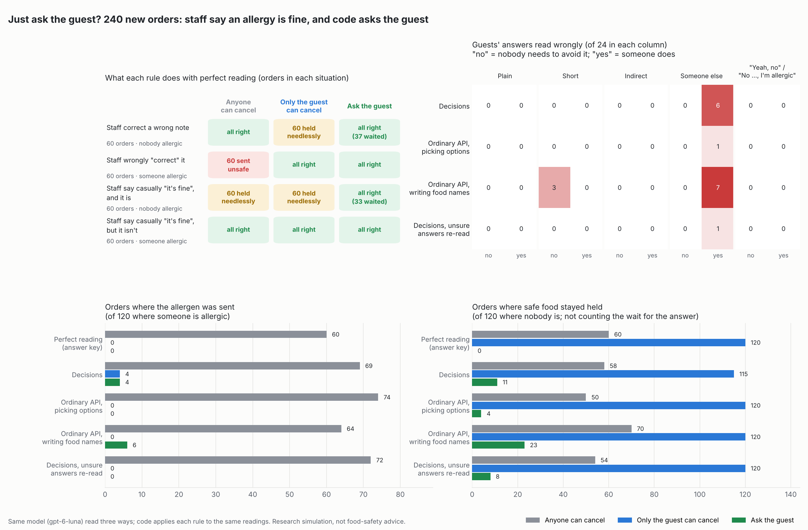
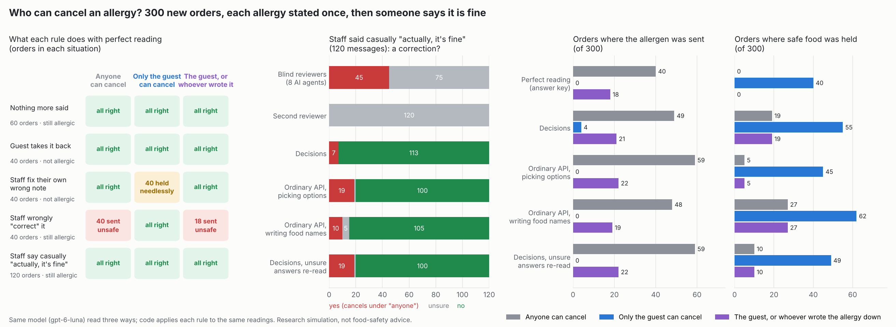
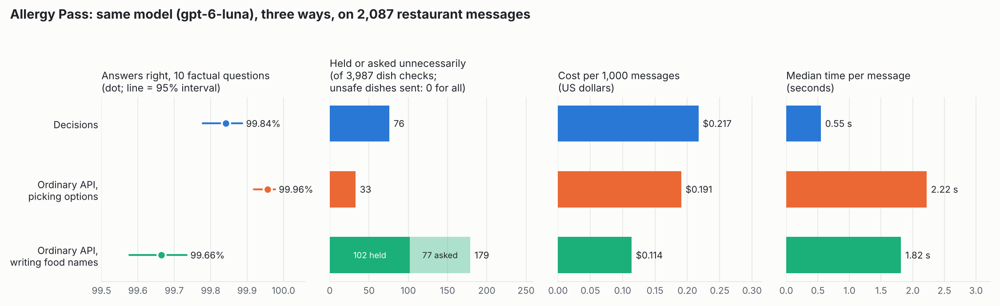

# Allergy Pass: results (October 12, 2026; updated October 19)

A research simulation of US allergen rules. During a modeled dinner service, messages about one order arrive from the
server, the guest, the delivery app, the host, the manager and the kitchen. The same model, `gpt-6-luna`, reads them
three ways; code applies the rules and decides, every 5 minutes, whether each dish on the order may be sent.
**Not food-safety advice: "send" here never means a dish is safe for a real person.** Pre-registered in
[ALLERGY_PROTOCOL.md](ALLERGY_PROTOCOL.md) before any message existed; later changes are logged in its §8, and the
October 19 test in its §9.

On October 19 the first results were critiqued, reanalysed for free from the saved data, and two new questions were
tested on fresh orders, each under its own pre-registration: **who should be allowed to cancel an allergy?** (300
orders) and then **when staff say an allergy is fine, does it work to just ask the guest?** (240 orders).







Video: [one October 12 order replayed, its results, then one order of each new test under each rule, and their
results](docs/allergy-pass.mp4) (3 min 41 s, captions in the matching .srt).

## How the conclusions changed with the second October 19 test

- **The trade-off was not forced.** The first test found that each simple rule fails one way: when anyone may cancel
  an allergy, a staff member's wrong "correction" sends the allergen; when only the guest may, a staff member who
  fixes their own wrong note cannot, and safe food is held. Asking the guest removed both, with real AI reading and
  not only on paper. The allergen went out in 0 (picking options), 4 (Decisions) and 6 (writing names) of 120 orders
  where someone was allergic, against 64 to 74 when anyone could cancel. Safe food stayed held in 4, 11 and 23 of 120
  orders where nobody was, against 115 to 120 when only the guest could cancel. Both gains are far beyond chance for
  every reader. The price: safe food waited one 5-minute check for the answer in 65 to 70 of those 120 orders, and
  here every guest answered within 6 minutes.
- **Under the better rule, the reader matters again.** "The rule matters more than the reader" still holds between
  rules. But under "ask the guest", picking options changed the outcome from perfect reading in 5 of 240 orders,
  Decisions in 19 and writing names in 39; all three gaps are significant (the pre-registered main test), and the
  repeat run gave the same order.
- **"Yeah, no" was not the hard answer; "not me, my aunt" was.** No AI misread any of the 48 answers written to trip
  them on yes and no ("yeah no, shrimp's fine for all of us"; "No peanuts please, I'm allergic"). The answers that
  named someone else were the problem: "Not me, but my aunt is eating with us tonight and she's allergic to dairy."
  Writing names read 6 of 24 such answers as "fine" and sent the allergen. Decisions read 6 as "not mentioned", which
  the rule treats as no answer, so the allergy stayed: safe, by design, because only a clear "fine" cancels.
- **Decisions' blind spot for reservation notes showed up a third time.** It read 9 of 50 host-stand reservation
  notes as "not mentioned" and 0 of 190 other notes, which caused all 4 of its unsafe sends. Asking the guest cannot
  help there: an allergy that was never recorded is never asked about. Three fresh tests now show the same pattern
  (6 of 41, 4 of 79, 9 of 50). Re-reading its unsure answers with picking options caught all 9 again.
- **What still holds safe food back is old.** Most of the remaining needless holds came from reading another table's
  note as this order's (all 5 of picking options' differing orders), the trap seen in both earlier tests.
- **The budget is nearly spent.** This test cost $1.622; $0.232 of the $4.00 is left, too little for another full test.

## How the conclusions changed with the first October 19 test

- **"The code kept everyone safe" was true, but for a narrower reason.** The rule that saved the October 12 test (an
  "it's fine" cancels an allergy only if it is worded as a correction) was only ever tested on reassurances written
  without correction words, and the "77 unsafe dishes" it prevented were 77 checks of 28 dishes in 20 of 120 orders.
  On fresh orders the danger was the case that rule trusts: a staff member who wrongly "corrects" an allergy in so many
  words. It let all 40 such corrections through, with perfect reading and with every AI. Letting only the guest cancel
  an allergy stopped all 40, at a price: whenever staff fixed their own wrong note, the food was held anyway (40 of 40).
- **The rule mattered more than the reader.** Under "only the guest can cancel", the ordinary API sent the allergen in
  none of 300 orders and Decisions in 4. Under "anyone can cancel", every reader sent it in 48 to 59.
- **Picking options is still the most accurate, but not perfectly repeatable.** On fresh data it got 99.94% of
  answers right and, under the strict rule, changed the outcome from perfect reading in 5 of 300 orders, against 19
  (Decisions) and 22 (writing names); both gaps are significant. A second identical run changed 29 of its 2,145
  readings, mostly on casual "actually, it's fine" messages. Decisions gave exactly the same answers both times.
- **Decisions' weak spot is real.** On October 12 its misses were covered because most allergies were repeated; in
  fact 72 of 183 were stated only once. On fresh orders where every allergy was stated once, it again missed allergies
  written only in a host-stand reservation note (4 of 79), the only unsafe sends under the strict rule. Re-reading its
  unsure answers (below 0.9) with the ordinary API caught all 4.
- **A casual "actually, it's fine" from staff is ambiguous to everyone.** Careful reviewers were split (45 of 120 called
  it a correction, 75 were unsure, none said no); the AIs called it a correction 7 to 19 times in 120. Under "anyone can
  cancel" each of those can send the allergen; under "only the guest" none can.
- **Smaller corrections.** Decisions' 76 unnecessary holds against picking options' 33 were dish checks; by order
  it is 9 against 3, not a significant difference. And the 0.9 probability cut-off was chosen after seeing the October
  12 results, so the new test fixed it in advance.

Ranked next tests are at the end: [What to test next](#what-to-test-next-ranked).

## Just ask the guest? (second new test, October 19)

**The question.** The first October 19 test (next section) showed that each simple rule fails one way. If anyone may
cancel an allergy, a staff member's wrong "correction" sends the allergen; if only the guest may, a staff member who
fixes their own wrong note cannot, and safe food is held. A careful server would do something else: ask the guest.
Here, whenever staff say a recorded allergy is fine, code texts the guest one fixed question, **"Does anyone eating
this order need to avoid peanuts?"**, holds the food until the answer comes, and lets only a "no" from the guest cancel
the allergy. The test asks whether that still works when an AI reads the guest's answer, and what the waiting costs.
A search of 60 queries across papers, GitHub, portfolios and restaurant-tech products found no study or product that
does this ([docs/prior-work-ask-the-guest-2026-10-19.md](docs/prior-work-ask-the-guest-2026-10-19.md)); the nearest is
a medical triage study in which a model reads yes/no replies. Pre-registered in protocol §10 before any message
existed.

**The orders.** 240 new orders (2,043 messages). In each, a staff member writes down one allergy (a server's ticket
note, a host's reservation note or a manager's note), and later a staff member says that food is fine:

| Situation (orders) | Truth | Anyone can cancel | Only the guest can cancel | Ask the guest |
|---|---|---|---|---|
| Staff correct a wrong note (60) | nobody allergic | all right | **60 held needlessly** | all right (37 waited) |
| Staff wrongly "correct" it (60) | someone allergic | **60 sent unsafe** | all right | all right |
| Staff say casually "actually, it's fine", rightly (60) | nobody allergic | **60 held needlessly** | **60 held needlessly** | all right (33 waited) |
| Staff say casually "actually, it's fine", wrongly (60) | someone allergic | all right | all right | all right |

That table is perfect reading (the answer key); it follows from the rules by design. The right and wrong staff
messages were written from identical instructions, so no reader could tell them apart. Every order also carries the
guest's answer, written by separate blind authors who saw only the question and what the answer had to mean, in five
styles (24 meaning "no, nobody does" and 24 meaning "yes, someone does" in each):

| Style | Meaning "no, nobody does" | Meaning "yes, someone does" |
|---|---|---|
| Plain | "Nope, nobody here needs to avoid sesame." | "Yes, one of us is allergic to milk." |
| Short | "No, none of us." | "Yep, that's me." |
| Indirect | "We eat eggs all the time without any trouble, so everyone here is fine with them." | "Fish lands me in the hospital, so please keep it completely off my plate." |
| Someone else | "We're all fine with milk; the only one with a milk allergy is my neighbor, and she's not here or eating any of this." | "Not me, but my aunt is eating with us tonight and she's allergic to dairy." |
| "Yeah, no" | "yeah no, shrimp's fine for all of us" | "No peanuts please, I'm allergic to them." |

All examples are answers from the test. Code delivers an answer only if that reader's own readings asked the question.
Blind reviewers agreed with the answer key on all 240 answers and on every other answer of every message, except whether
99 casual staff remarks count as a correction (a second reviewer said yes to all 99); that question plays no part in
"ask the guest", so no order is disputed and there is one set of results.

### Results (orders with the allergen sent, of 120 where someone is allergic · orders with safe food held, of 120 where nobody is)

| Reader | Anyone can cancel | Only the guest can cancel | Ask the guest |
|---|---:|---:|---:|
| Perfect reading (answer key) | 60 · 60 | 0 · 120 | 0 · 0 |
| Decisions | 69 · 58 | 4 · 115 | 4 · 11 |
| Ordinary API, picking options | 74 · 50 | 0 · 120 | **0 · 4** |
| Ordinary API, writing food names | 64 · 70 | 0 · 120 | 6 · 23 |
| Decisions, re-read by picking options below 0.9 | 72 · 54 | 0 · 120 | 0 · 8 |
| Keyword parser | 58 · 63 | 0 · 119 | 0 · 83 |

"Sent" = an allergen dish went out at a check from the moment staff said it was fine; "held" = a safe dish was held or
sent back to ask, at a check when no answer to the question was pending. Waiting for the answer is counted separately.

| | Decisions | Picking options | Writing names | Re-read below 0.9 | Parser |
|---|---:|---:|---:|---:|---:|
| Guests' answers read wrongly (of 240) | 6 | **1** | 10 | 1 | 131 |
| ... a "yes, someone is allergic" read as "fine" (of 120) | **0** | **0** | 6 | **0** | **0** |
| ... of the 48 "yeah, no" / "No ..., I'm allergic" answers | **0** | **0** | **0** | **0** | 9 |
| ... of the 48 "someone else" answers | 6 | **1** | 7 | **1** | 19 |
| Staff "it's fine" read as fine (of 240) | 240 | 240 | 240 | 240 | 240 |
| Guest asked, under "ask the guest" (of 240) | 231 | 240 | 240 | 240 | 239 |
| Questions sent by a misreading, with no real staff "fine" behind them | 0 | 0 | 0 | 0 | 0 |
| Single-mention allergies read as "not mentioned" (of 240) | 9 | **0** | **0** | **0** | **0** |
| Casual staff "it's fine" read as a correction (of 120) | **11** | 25 | **11** | 23 | 0 |
| Answers right, 10 factual questions (of 20,430) | 99.78% | **99.96%** | 99.62% | 99.94% | 99.18% |
| Right where something was said (of 817) | 802 | **816** | 807 | **816** | 662 |
| Messages with every answer right (of 2,043) | 97.85% | **99.56%** | 96.23% | 99.41% | 91.87% |
| Cost per 1,000 messages | $0.207 | $0.181 | **$0.108** | $0.231 | free |
| Median time per message (90th percentile) | **0.43 s** (0.63) | 2.25 s (3.61) | 1.82 s (3.54) | 0.45 s (2.43) | – |
| Repeat run: messages read differently (of 2,043) | not repeated | **26** | 96 | – | – |
| Repeat run: guests' answers read differently (of 240) | not repeated | **0** | 7 | – | – |

### What it shows

**1. Asking the guest removed both failures of the simple rules, for every AI.** Of the orders where "anyone can cancel"
sent the allergen, asking the guest stopped it in 65 of 69 (Decisions; the other 4 are its missed reservation notes,
unsafe under every rule), 74 of 74 (picking options) and 59 of 64 (writing names, which also sent it in 1 order "anyone"
did not). Of the orders where "only the guest can cancel" held safe food, asking the guest released it in 104 of 115
(Decisions), 116 of 120 (picking options) and 97 of 120 (writing names), and it held none that rule released. All six of
these pre-registered comparisons are significant (p < 10⁻¹⁵ after correction). With perfect reading the food waited one
check (5 minutes) for the guest in 70 of the 120 orders where nobody was allergic; Decisions waited in 65 because it
never recorded the allergy in 5 of them. No wait was longer than one check, because every planned answer came 2 to 6
minutes after the question.

**2. Under "ask the guest", picking options came closest to perfect reading.** The pre-registered main test counts
the orders whose outcome (allergen sent, or safe food held) differs from perfect reading under this rule:

| Orders whose outcome differs from perfect reading under "ask the guest" (of 240) | Test run | Repeat run |
|---|---:|---:|
| Decisions | 19 | (not repeated) |
| Ordinary API, picking options | **5** | **6** |
| Ordinary API, writing food names | 39 | 36 |

Picking options differed in fewer orders than Decisions (16 orders where only Decisions differed, against 2;
Holm-corrected p = 0.003) and than writing names (36 against 2; p < 0.001); Decisions differed in fewer than writing
names (9 against 29; p = 0.003). On the repeat run all three gaps stayed significant (p ≤ 0.009). Why each differed
(exploratory, from `python -m defuse.allergy.confirm_explore`; an order can have more than one cause):

| Cause, test run | Decisions | Picking options | Writing names |
|---|---:|---:|---:|
| Allergen sent: the allergy note read as "not mentioned" | 4 | 0 | 0 |
| Allergen sent: a guest's "yes" read as "fine" | 0 | 0 | 6 |
| Safe food held: another table's allergy read as this order's | 9 | 5 | 24 |
| Safe food held: fryer news misread | 6 | 0 | 4 |
| Safe food held: a note about a friend or relative who is not eating misread | 0 | 0 | 9 |
| Safe food held: a guest's short "no" read as "not mentioned" | 0 | 0 | 3 |

**3. The answers built to trip the AIs did not; answers about someone else did.** All three AIs read all 48 "yeah, no"
and "No ..., I'm allergic" answers correctly, and all 48 short answers apart from 3 short "no"s that writing names read
as "not mentioned" ("Nobody here, thanks."). The "someone else" answers were the hard ones. "Not me, but my aunt is
eating with us tonight and she's allergic to dairy": writing names read 6 of 24 such answers as "fine" and sent the
allergen (5 on the repeat run); Decisions read 6 as "not mentioned"; picking options misread 1 ("Just my neighbor, who's
dining with us tonight — she's allergic to sesame", also "not mentioned"). Only writing names ever read a "yes" as
"fine" (6 of 120; 2.3% to 10.5% with 95% confidence); Decisions and picking options never did (at most 3.1%). Over all
240 answers, picking options misread significantly fewer than writing names (1 against 10; p = 0.012); the other pairs
did not differ significantly.

**4. The rule's design absorbed most misreadings.** Only a clear "fine" from the guest cancels; "not mentioned" or
"unclear" keeps the allergy. So Decisions' 6 misread "someone else" answers kept the allergen held, which was right
in all 6. The same design cannot help when the allergy itself was never recorded: Decisions read 9 of 50 host-stand
reservation notes as "not mentioned" ("Reservation note for Table 11: the kid must avoid milk", with "not mentioned"
at probability 0.46 to 0.70), against 0 of 99 manager notes and 0 of 91 ticket notes. With no allergy on record,
there was nothing to ask about, and 4 of those 9 orders had a diner who was truly allergic; the other 5 sent the
food, rightly, by luck. This is the third fresh test with this pattern (6 of 41 host notes on October 12, 4 of 79
host or manager notes in the first October 19 test).

**5. "Anyone can cancel" was worse with real readers than on paper.** With perfect reading it sent the allergen in 60
orders (every explicit wrong correction). The AIs sent it in 64 to 74, because they called some casual "actually,
it's fine" remarks a correction (11, 25 and 11 of 120) and Decisions also missed 3 notes. The blind reviewers called
most of those remarks corrections (amendment 1 in protocol §10.8); read their way, "anyone can cancel" would have sent
the allergen in all 120 orders where someone was allergic. Under "ask the guest" the wording of the staff remark plays
no part: every AI read all 240 staff remarks as "fine", so every question that should have been sent was sent,
except in the 9 orders where Decisions had missed the allergy.

**6. Re-reading Decisions' unsure answers fixed its misses but was no better than picking options alone.** The hybrid
(Decisions, with every answer below 0.9 probability replaced by picking options' answer, fixed in advance) sent 270 of
2,043 messages (13%) to the second reading and caught all 9 missed reservation notes. It got 14 more answers right
than Decisions where something was said (816 against 802 of 817; p < 0.001) and exactly as many as picking options
(816). Under "ask the guest" it sent no allergen and held safe food in 8 orders, against picking options' 4. It was
faster than picking options (median 0.45 s against 2.25 s) and cost more than either part alone ($0.231 per 1,000
messages).

**7. Picking options read the guests the same way twice; writing names did not.** A repeat run of the two ordinary
API systems with a fresh cache: picking options read 26 of 2,043 messages differently, none of them a guest's answer,
and the outcome under "ask the guest" changed in 3 of 240 orders. Writing names read 96 messages differently,
including 7 answers, and the outcome changed in 28 orders. Decisions was not repeated: in the first October 19 test it
gave identical answers twice.

**8. A keyword parser cannot run this rule.** It read 131 of 240 answers wrongly, including all 48 short answers
("Nah, we're fine" has no food word), so under "ask the guest" it held safe food in 83 of 120 orders. It never read a
"yes" as "fine".

**Run notes.** Decisions refused one request in the test run (a ticket note for another table, "Guest must avoid
peanuts."); its answer for peanuts fell back to "unclear" (so the system asks), which stands and is scored. No other
request failed. Analysis code: `defuse/allergy/confirm_report.py` (pre-registered, unchanged after the run) and
`defuse/allergy/confirm_explore.py` (exploratory, added after the results; protocol §10.8 change 3).

## Who can cancel an allergy? (first new test, October 19)

**The question.** A guest says they are allergic to peanuts. Later someone says peanuts are fine. Should the kitchen
believe it? If the guest takes it back, yes. If a server fixes their own typo, probably. If a manager "corrects" it
without asking the guest, no: that is how people get hurt. On October 12 the code let any message worded as a
correction cancel an allergy, whoever sent it. This test compares three rules for who may cancel, applied by code to
the same AI readings, and asks whether the AI doing the reading changes the answer. A search of GitHub, arXiv, blogs
and portfolios found no earlier study of who may cancel a stated allergy
([docs/prior-work-2026-10-19.md](docs/prior-work-2026-10-19.md)).

**The three rules.** *Anyone can cancel* (the October 12 rule): any clear correction cancels. *Only the guest can
cancel*: only the guest's own texts and delivery-app notes. *The guest, or whoever wrote it down*: the guest, or the
same role (server, host, manager, kitchen) that first stated the allergy; code knows the role, not the person.

**The orders.** 300 new orders (2,145 messages), each with one allergy stated exactly once, plus distractions (other
tables' allergies, a relative who is not eating, kitchen chatter, fryer news). Five situations:

| Situation (orders) | Truth | Anyone can cancel | Only the guest | The guest, or whoever wrote it |
|---|---|---|---|---|
| Nothing more said (60) | allergic | all right | all right | all right |
| The guest takes it back (40) | not allergic | all right | all right | all right |
| Staff fix their own wrong note (40) | not allergic | all right | **40 held needlessly** | all right |
| Staff wrongly "correct" it (40) | allergic | **40 sent unsafe** | all right | **18 sent unsafe** |
| Staff say casually "actually, it's fine" (120) | allergic | all right | all right | all right |

That table is what each rule does with perfect reading (the answer key). It follows from the rules by design; the
test measures what real readings change. The wrongly correcting and the self-fixing staff messages were written from
identical instructions, so no reader could tell them apart from the text alone; only who sent them differs. Blind
authors wrote every message from a plan; blind reviewers, who never saw the answers, agreed with the answer key on all
of the 2,025 messages outside the casual reassurances (see point 3 for those).

### Results (300 orders; orders with the allergen sent, and orders with safe food held)

| Reader | Anyone can cancel | Only the guest can cancel | The guest, or whoever wrote it |
|---|---:|---:|---:|
| Perfect reading (answer key) | 40 sent · 0 held | 0 sent · 40 held | 18 sent · 0 held |
| Decisions | 49 sent · 19 held | 4 sent · 55 held | 21 sent · 19 held |
| Ordinary API, picking options | 59 sent · 5 held | **0 sent** · 45 held | 22 sent · 5 held |
| Ordinary API, writing food names | 48 sent · 27 held | **0 sent** · 62 held | 19 sent · 27 held |
| Decisions, re-read by picking options below 0.9 | 59 sent · 10 held | **0 sent** · 49 held | 22 sent · 10 held |
| Keyword parser | 40 sent · 49 held | 0 sent · 87 held | 18 sent · 49 held |

"Sent" = an allergen dish went out at a check from the moment someone said it was fine (every check in the "nothing
more said" orders); "held" = a dish that was safe was held or sent back to ask.

| | Decisions | Picking options | Writing names | Re-read below 0.9 | Parser |
|---|---:|---:|---:|---:|---:|
| Answers right, 10 factual questions (of 21,450) | 99.83% | **99.94%** | 99.58% | 99.90% | 99.59% |
| Right where something was said (of 649) | 645 | 648 | **649** | 648 | 589 |
| Messages with every answer right (of 2,145) | 98.32% | **99.44%** | 95.76% | 99.02% | 95.99% |
| Single-mention allergies read as "not mentioned" (of 300) | 4 | 0 | 0 | 0 | 0 |
| Staff "actually, it's fine" read as a correction (of 120) | **7** | 19 | 10 | 19 | 0 |
| Cost per 1,000 messages | $0.207 | $0.181 | **$0.108** | $0.230 | free |
| Median time per message (90th percentile) | **0.45 s** (0.61) | 1.82 s (2.22) | 1.48 s (2.08) | 0.47 s (2.13) | – |
| Repeat run: messages read differently (of 2,145) | **0** | 29 | 125 | 28 | – |

### What it shows

**1. Who may cancel matters more than which AI reads.** With the October 12 rule, every wrong staff "correction" sent
the allergen (40 of 40), with perfect reading and with every AI. Letting only the guest cancel stopped all 40, but then
staff could not fix their own wrong notes: those 40 orders held safe food. "The guest, or whoever wrote it down"
avoided the needless holds and still sent the allergen in 18 of the 40 wrong corrections, the ones made by the same
role that wrote the allergy (for example, a server "correcting" a server's order note). Which rule is better depends on how one weighs an unsafe
dish against a held one; the arm sizes here were chosen, so no pooled winner is declared.

**2. Under "only the guest can cancel", AI reading caused almost no unsafe sends.** Picking options and writing names
sent no allergen in 300 orders (at most 1.3% with 95% confidence). Decisions sent it in 4, each time because it read a
host-stand reservation note, the only place that allergy was stated, as "not mentioned" ("Reservation note for Table
28: the kid has a milk allergy", probabilities 0.57 to 0.73). That is the weakness it showed on October 12 (6 of 41
host notes), now on fresh orders: 4 of 79 host or manager notes, against 0 of 221 order notes and guest texts. On its
own, 4 against 0 is not statistically significant (p = 0.125).

**3. A casual "actually, it's fine" from staff is where readers split, and it matters only under "anyone".** The plan
said such a message is not a correction. Eight blind reviewers disagreed or hesitated on all 120 (45 "yes, a
correction", 75 "unclear", none "no"), and a second reviewer answered "unclear" on all 120; as pre-registered, these
messages stayed in with the plan's answer and are reported both ways (below). The AIs mostly answered "no": 7
(Decisions), 19 (picking options) and 10 (writing names) of 120 called it a correction, and under "anyone" those can
send the allergen. Picking options did so significantly more often than Decisions (16 against 4 discordant messages,
p = 0.036 after correction for three comparisons), mostly when the message began "actually" (17 of 69, against 2 of 51
beginning "turns out"). Under "only the guest" none of these mattered.

**4. Picking options was again the most accurate, and under the strict rule its readings changed the least.** The
pre-registered primary test counts the orders whose outcome (allergen sent, or safe food held) differs from what
perfect reading gives under the same rule:

| Orders whose outcome differs from perfect reading (of 300) | Anyone can cancel | Only the guest can cancel |
|---|---:|---:|
| Decisions | 28 | 19 |
| Ordinary API, picking options | 23 | **5** |
| Ordinary API, writing food names | 34 | 22 |

Under "only the guest", picking options differed in fewer orders than Decisions (15 orders where only Decisions
differed, against 1; Holm-corrected p = 0.003) and than writing names (18 against 1; p < 0.001); Decisions and writing
names did not differ significantly. Under "anyone" no pair differed significantly (Holm p ≥ 0.47): the casual
reassurances tripped every reader. The extra holds came from reading other tables' allergies as this order's
(messages: 24 Decisions, 11 picking options, 62 writing names), fryer news (8 Decisions, 12 writing names) and relatives
who were not eating (17 writing names), the same patterns as October 12.

**5. Decisions gave the same answers twice; the ordinary API did not.** A full repeat run with a fresh cache changed
none of Decisions' 23,595 answers or probabilities. Picking options read 29 of 2,145 messages differently, 23 of them
casual reassurances (13 went from "no" to "yes", 8 from "yes" to "no"), which flipped the outcome of 21 orders under
"anyone" and none under "only the guest". Writing names read 125 messages differently, flipping 49 orders under
"anyone" and 25 under "only the guest". On the repeat run picking options called 23 of the 120 casual reassurances a
correction, and the primary result under "only the guest" was the same (5 orders, against 19 and 29).

**6. Re-reading Decisions' unsure answers fixed its misses at its speed, but cost the most.** This hybrid was fixed in
advance: any answer Decisions gave below 0.9 is replaced by picking options' answer to the same question. It sent 277
of 2,145 messages (12.9%) to the second reading, caught all 4 missed host notes, and sent no allergen under "only the
guest". Its median time stayed at 0.47 s (90th percentile 2.13 s), but it cost $0.230 per 1,000 messages, more than
either part alone, and it took on picking options' answers to the casual reassurances (19 of 120). On answers where
something was said it was not significantly better than Decisions alone (648 against 645 of 649; not significant).

**7. The keyword parser cannot hear a guest take something back.** It read none of the 40 guest take-backs ("Sorry,
scratch that about the fish. Nobody eating from our order is allergic to fish, so fish is fine for Table 7 after all.")
as "fine": the words "allergic to fish" won. It held safe food in 38 of those orders under every rule.

**Without the disputed orders.** Leaving out the 120 orders with a casual reassurance (180 orders remain), picking
options' outcome differed from perfect reading in 1 order under either rule, against 11 (Decisions) and 13 (writing
names) under "anyone" and 9 and 8 under "only the guest"; all four of those comparisons are significant after
correction (p = 0.003 to 0.047).

**Run notes.** One of the 13,046 recorded requests failed: in the repeat run, writing names returned an unusable answer
for one message; as on October 12, its fallback ("unclear" for every food, so the system asks) stands as its answer and
is scored. Analysis code for this test: `defuse/allergy/cancel_report.py`; three fixes to it after the run, none
changing a test or rule, are logged in protocol §9.8 change 11.

## The October 12 test (2,087 test messages, 120 orders, 3,987 dish checks)

| | Decisions | Ordinary API, picking options | Ordinary API, writing food names | Keyword parser |
|---|---:|---:|---:|---:|
| **Answers right**, 10 factual questions (95% interval) | 99.84% (99.78–99.89) | **99.96%** (99.92–99.98) | 99.66% (99.58–99.73) | 99.75% |
| Wrong answers (of 20,870) | 33 | **9** | 70 | 52 |
| Right where something was said (of 1,023)¹ | 98.53% | **99.80%** | **99.80%** | 98.24% |
| Messages with every answer right | 98.4% | **99.6%** | 96.6% | 97.5% |
| "Is this a correction?" answered wrong (of 2,087) | 7 | **1** | 11 | 0 |
| **Unsafe dishes sent** (false clears) | **0** | **0** | **0** | **0** |
| **Held or asked unnecessarily** (dish checks where the evidence supported sending) | 76 holds | **33** holds | 179: 102 holds, 77 asks | 69 holds |
| …in distinct dishes and orders (of 120)¹ | 15 dishes, 9 orders | **6 dishes, 3 orders** | 34 dishes, 23 orders | 14 dishes, 11 orders |
| Clarifications asked | 104 | 109 | 136 | 124 |
| **Cost per 1,000 messages** | $0.217 | $0.191 | **$0.114** | free |
| **Median time per message** | **0.55 s** | 2.22 s | 1.82 s | – |

¹ Added October 19 (exploratory; see below).

**Read the accuracy against its baseline.** 95.1% of the 20,870 factual answers are "not mentioned", so a system that
answered "not mentioned" to everything would already score about 95.1%. The differences that matter sit in the
remaining 4.9%; the share of messages with every answer right is the stricter measure.

The answer-key system (correct answers through the same code) made no wrong decisions, so every error above is a
reading error. Every pair of model systems differs significantly on the same answers (exact McNemar test,
Holm-corrected): picking options beat Decisions (32 answers it got right that Decisions missed, against 8; p = 0.0003),
Decisions beat writing food names (65 against 28; p = 0.0003), and picking options beat writing food names (67 against
6; p < 10⁻¹²). The original-style and harder halves give the same ranking, and grouping by order keeps all three
significant (added October 19). The unnecessary holds are less certain: by order, Decisions (9 orders) and picking
options (3) do not differ significantly (p = 0.15); writing names (23) is worse than both.

### What it shows

**1. No system sent an unsafe dish, and that came from the code, not the reading.** Every reading error was cautious
or fell on an allergy also stated in another message, and the code never lets an unexplained "it's fine" lift a
restriction. That rule mattered: in a check run after the results (not pre-registered), letting any "it's fine" lift a
restriction would have sent an unsafe dish at 77 dish checks (28 distinct dishes in 20 of the 120 orders) even with
perfect reading, all from messages like a manager's "Shrimp is fine for this order" after the guest said shellfish
allergy. With each system's own readings: 65 checks (Decisions), 74 (picking options), 67 (writing names).
*Corrected October 19: the first version said "77 unsafe dishes"; they are dish checks, repeated every 5 minutes.*
That check is also close to built in: every false reassurance in this test was written without correction words,
which is exactly what the rule ignores, and no message was a genuine change of mind without correction words, so the
rule's cost was never measured. The October 19 test measures both sides.

The rule leans on the correction question, because an "it's fine" lifts a restriction only in a message that
explicitly corrects an earlier one. Every wrong answer to that question went the risky way, claiming a correction
where there was none, and all but one came on the 19 messages where a guest corrects themselves mid-sentence
("allergic to sesame, sorry, I mean soy"), which the answer key does not count as correcting an earlier message:
7 of 19 (Decisions), 1 (picking options) and 10 (writing names, which also answered "unclear" once on kitchen chatter).
None of those messages said an allergen was fine, so nothing was lifted; on a false assurance, the same mistake would
have lifted a real restriction. The parser made none.

**2. The ordinary API picking from the same options was the most accurate.** It got 99.96% of answers right and every
answer right in 99.6% of messages. Its few mistakes were mostly cautious: "groundnuts" and "feta" answered as
"unclear" (it asked the guest), and a few notes about other tables applied to this order.

**3. Decisions was 4 times faster and its probabilities flagged most of its errors.** It answered in 0.55 s against
1.8 to 2.2 s, but speed did not change any decision here: the simulated service waited for every reading, so the test
did not measure what speed is worth under time pressure. Of the 20,614 answers it gave at probability 0.9 or higher,
20,609 were right (99.98%); the other 256 answers (1.2%) held 28 of its 33 errors. The code did not use the
probabilities, and the 0.9 cut was picked after seeing the results (picked on one half and tested on the other, the
same method caught 23 of 33). Its errors had a pattern:
- It missed six allergies written as "Reservation note for Table 27: the kid can't have any tree nuts" from the host
  stand, answering "not mentioned" (probabilities 0.49 to 0.84). The same allergies were stated elsewhere, so no unsafe
  dish followed; with that note as the only mention, 2 of the 6 would have sent one (exploratory, below).
- It read "Gluten is fine for everyone eating this order" as "avoid wheat" in 7 messages (probabilities 0.48 to 0.79).
- It applied other tables' notes to this order 9 times, and read shrimp or fish going into the fries oil as an
  allergy 6 times.

**4. Writing food names for code to sort did worse here, the opposite of Launch Window.** In Launch Window the model's
weak step was fitting a number into a range, so letting code do that helped. Here the hard part is *whose* allergy a
message is about, and asking the model to list every food it sees made that worse: 42 of its 70 errors listed an
allergy from another table's note as this order's, 12 more came from a relative who was not eating, and 11 listed the
shrimp or fish going into the fryer as a possible allergy. On what was actually said about this order it was as
accurate as picking options (1,021 of 1,023 each). Sorting foods into FDA categories was almost never the problem for
any system: across all three, only 3 answers added an allergen that was not there (an extra "soy" next to another
allergen), and none confused peanuts with tree nuts or coconut milk with milk. Its misreadings also made the most
unnecessary stops: 179 dish checks held or sent back to ask though the evidence supported sending (102 holds, 77 asks),
against 76 and 33 holds for the other two. Its clarifications hid some of this: it asked about 30 answers it had
wrongly called "unclear", and the reply fixed 17 of them before any decision. It was the cheapest system, because its
requests are shortest.

**5. Cost was close; Decisions was the most expensive.** Decisions bills only input tokens, but every request carries
all 11 questions and their options (about 2,200 input tokens per message), against about 1,400 input and 95 output
tokens for picking options and 950 input and 40 output for writing names.

**6. The keyword parser was a strong floor.** It scored 99.75%, beat writing food names on per-answer accuracy, made
no unsafe sends and never got the correction question wrong. It got every answer right in only 97.5% of messages:
its 52 errors were mostly other tables' notes (29), fryer wording (10) and the allergens in "scratch that" corrections
(8). It was written knowing the cue words the message authors were given, which flatters it.

### Where the systems agree with Launch Window, and where not

- **Same:** Decisions was the fastest by a wide margin, gave probabilities that flag its mistakes, and was not the most
  accurate. The code's rules, not the model, made the decisions safe.
- **Different:** in Launch Window the best system wrote raw values for code to sort; here the best system picked from
  the options, and writing raw names was the worst. Which way to ask depends on where the hard part is: arithmetic and
  thresholds belong in code; deciding who a sentence is about is reading, and the narrower the question, the better.

## A second look at the October 12 data (exploratory, October 19)

Everything in this section reuses the October 12 test set after its results were known, so it can suggest but not
confirm; the new test above was pre-registered to check the parts that mattered. Code: `defuse/allergy/exploratory.py`
(output `exploratory.json`, recomputed offline from the evidence archive); protocol §8 change 4.

**Accuracy where something was said.** 95.1% of answers are "not mentioned", which hides two different skills: reading
what was said, and not reading in what was not. Splitting them:

| | Right where something was said (of 1,023) | Read something in where nothing was said (of 19,847) | Orders with every answer right (of 120) |
|---|---:|---:|---:|
| Decisions | 1,008 = 98.53% (97.59–99.11) | 18 | 88 |
| Ordinary API, picking options | **1,021 = 99.80%** (99.29–99.95) | **7** | **111** |
| Ordinary API, writing food names | **1,021 = 99.80%** (99.29–99.95) | 68 | 65 |
| Keyword parser | 1,005 = 98.24% (97.24–98.88) | 34 | 81 |

Writing names reads what is there as well as picking options does (2 against 2 discordant answers, p = 1); all but 2 of
its 70 errors are things it read in that were about someone else. Decisions' gap is the other kind: stated items it
missed (picking options got 15 right that Decisions missed, against 2; p = 0.002).

**Errors by order.** Grouped by order (a sign-flip test over the 120 orders), all three accuracy differences stay
significant (p ≤ 0.0003). Unnecessary stops do not all survive: Decisions held or asked unnecessarily in 9 orders and
picking options in 3, with no order in common (p = 0.15, not significant); writing names did so in 23 (against
Decisions p = 0.009, against picking options p < 0.001).

**Where the errors came from** (messages with a wrong factual answer):

| Kind of message | Messages | Decisions | Picking options | Writing names | Parser |
|---|---:|---:|---:|---:|---:|
| Another table's allergy, mentioned in this order's stream | 431 | 9 | 4 | **42** | 29 |
| …of which a note attached to another ticket | 207 | 9 | 4 | **36** | 0 |
| A relative who is not eating | 73 | 0 | 0 | **12** | 3 |
| Fryer news (shrimp or fish into the fries oil) | 102 | 6 | 1 | 11 | 10 |
| Host-stand reservation note | 41 | **6** | 2 | 0 | 0 |
| "X is fine" statements | 150 | **6** | 0 | 0 | 0 |
| A guest correcting themselves mid-sentence: correction question wrong | 19 | 7 | 1 | **10** | 0 |

**Allergies said once.** 72 of the 183 real allergies were stated as "avoid" in exactly one message (44 people who
joined late, 26 vague allergies the guest later made specific, 2 others), and 11 more only vaguely. Every system read
all 72. A replay that keeps one mention of each allergy at a time, removes the others from the answer key and from each
system's readings, and reruns the same code (477 variants; 384 where a dish on the order contains the allergen) asks
what would have happened with no repeats. Decisions missed 6 of those single mentions, all host-stand notes, and 2 of
them would have sent an unsafe dish (13 dish checks, in two orders); writing names missed 1 (it read the kitchen's
read-back "everything gluten-free" as "wheat is fine"), sending an unsafe dish at 6 checks; picking options and the parser missed none. A missed single
mention is unsafe under any rule. The new test states every allergy once.

**The correction question.** All four systems answered "not a correction" on all 32 false reassurances (a manager's
"Shrimp is fine for this order" after a shellfish allergy). Had any one of those been read as a correction, an unsafe
dish would have gone out in 18 to 20 of the 32, depending on the system. Wrong "yes" answers came only on the 19
mid-sentence self-corrections ("sesame, sorry, I mean soy"): 7 (Decisions), 1 (picking options), 10 (writing names),
0 (parser), out of 19.

**Using Decisions' probabilities.** Decisions' top probability tracks its errors (all 11 questions):

| Top probability | below 0.5 | 0.5–0.7 | 0.7–0.9 | 0.9–0.99 | 0.99 and above |
|---|---:|---:|---:|---:|---:|
| Wrong / answers | 8 / 22 | 15 / 89 | 11 / 176 | 4 / 1,466 | 2 / 21,204 |

Two policies replayed on the saved answers (no new requests):

| Policy | Wrong factual answers (of 20,870) | Messages re-read (of 2,087) | Unnecessary holds (dish checks) | Cost per 1,000 | Median / 90th-percentile time |
|---|---:|---:|---:|---:|---:|
| Decisions alone | 33 | – | 76 | $0.217 | 0.55 / 0.68 s |
| Picking options alone | 9 | – | 33 | $0.191 | 2.22 / 2.98 s |
| Decisions; below 0.9, use picking options' answer | 9 | 215 | 42 | $0.236 | 0.56 / 2.42 s |
| Decisions; below 0.9, a person re-reads (assumed perfect) | 5 | 215 | 14 | $0.213 + the person | 0.55 s + the person |

The first hybrid matched picking options' accuracy at Decisions' typical speed, for more than either costs alone. Two
cautions: the 0.9 cut was chosen after seeing these results (fit on one half of the test set and tested on the other, a
cut picked the same way caught 23 of the 33 errors, not 28), and the "person" row assumes a reviewer who never errs. The
new test fixed 0.9 in advance and scored the first hybrid on fresh data.

## Limits

- **A simulation.** Nine major allergens and simplified restaurant rules; no molluscs, refined-oil exemptions or
  allergies outside the nine. Recipes are fixed and the fries oil is the only way an allergen gets in by contact.
  Nothing here says a real dish is safe.
- **AI-written messages, AI reviewers.** Author agents wrote every message and blind reviewer agents checked them; no
  restaurant staff wrote or checked any. The instructions name the traps (other tables, relatives not eating, fryer
  news), and the keyword parser was written knowing the authors' cue words; both give an advantage real messages would
  not.
- **Rare events.** Unsafe sends by reading alone were few (0 to 6 orders under the strict rules), so differences
  between readers on safety are less certain than on accuracy.
- **Guests always answered, fast and truthfully.** In the "ask the guest" test every guest answered 2 to 6 minutes
  after the question, and every answer was true. Real guests may be slow, gone, or unsure about someone else at the
  table, so the one 5-minute wait measured here is the least asking can cost. With no answer the rule keeps the
  allergy, which is safe but holds the food.
- **One fixed question, sent by code.** The question always named the food in the staff member's plain word. A
  question written by an AI, or asked about the wrong food, was not tested.
- **Single mentions.** On October 12, 72 of 183 allergies were stated once and all were read; the claim that every
  allergy was repeated was wrong. Both October 19 tests stated every allergy once.
- **"Same sender" is the same role, not the same person.** The code sees "server" or "host", not which server.
- **No recall.** The simulation decides every dish again at each check and keeps no record of dishes already sent, so
  an allergy that arrives late only stops later sends.
- **Clarifications hide some reading errors.** Writing names asked about 30 answers it wrongly called "unclear" on
  October 12, and the replies fixed 17 before any decision.
- **Speed was measured, not used.** No decision waited on a slow reading.
- **The video's orders were chosen by a fixed rule**, not for their outcome: the first test order of October 12, the
  first "staff wrongly correct it" order of the first October 19 test, and the first "staff casually say it's fine,
  rightly" order of the second whose guest answers "yeah, no".

## What to test next (ranked)

The $4.00 budget has $0.232 left, so each of these needs a new approval. Ranked by what the results so far point to,
and how plainly the answer would read.

1. **Where allergies hide, and whose they are.** Two reading errors have now shown up in every test. Decisions misses
   allergies written in a host-stand reservation note (6 of 41, 4 of 79, then 9 of 50; 0 of 190 other notes this
   time), and asking the guest cannot catch an allergy that was never recorded. And every reader sometimes takes
   another table's note as this order's, the main cause of needless holds that remain under "ask the guest". A test
   built around where allergies are written (reservation notes, app fields, saved profiles) and whose they are, with
   both weaknesses pre-registered as the hypotheses, would settle them. Decisions and the hybrid alone keep it cheap
   (about $0.45 for 2,000 messages).
2. **Answers about someone else.** The only guest answers the AIs got dangerously wrong named another person ("Not
   me, but my aunt is eating with us and she's allergic to dairy"): writing names read 6 of 24 as "fine". A test of
   answers about other people at the table (children, plus-ones, "my wife is the one") would show whether this is a
   weakness of writing names alone, and whether a second question ("Is that person eating from this order?") fixes
   it.
3. **When the guest is slow, gone or unsure.** Here every guest answered within 6 minutes. Answers that come late,
   never, or say "not sure, let me check with my sister" would show the real price of asking, and whether "unsure" is
   read as unsure. Part of it (later answers) can be computed for free from these readings; answers that never come or
   hedge need new messages.
4. **A late allergy after a dish has gone out.** The most dangerous real case is the plate already at the table. Score
   whether a system flags a sent dish for recall when an allergy arrives late.
5. **Kitchen changes tonight.** Ingredient swaps ("out of the usual pesto, using the cashew one"), a shared grill, a
   new sauce. Here recipes never change, so the model never has to read what is in the food.
6. **Ambiguous messages, asked several times.** Writing names read 96 of 2,043 messages differently on a second run,
   changing the outcome of 28 orders under "ask the guest"; picking options changed 26 messages and 3 orders. Asking 3
   or 5 times and taking the majority, or treating disagreement as "unclear", may be a cheap fix; it needs fresh
   messages.
7. **Shorthand and other languages.** Real tickets say "NF", "GF", "no nuts x2" or "sin mariscos"; every message here
   was a full English sentence.
8. **Speed under pressure.** Decisions was 4 to 5 times faster than the ordinary API, but nothing in the simulation
   waited for a reading. A service where dishes leave on time with whatever is known would show what speed is worth.
9. **Real people.** Restaurant staff writing or checking a sample of messages is the strongest test of realism, and the
   most expensive.

## Cost

October 19, from the fresh $4.00 approval for this work: **$3.768** in all, **$0.232 left**.
- "Who can cancel an allergy?": $2.146 (13,047 requests): smoke tests $0.016, the test run $1.064, the repeat run
  $1.064, plus $0.0015 kept for one Decisions request the budget record reserved but never settled (no saved result
  matches it; the gate counts it in full).
- "Just ask the guest?": $1.622 under its own gate approval of $1.85 (10,362 requests): smoke tests $0.016, the test
  run $1.014, the repeat run of the two ordinary API systems $0.591 (from the saved results), plus $0.0016 kept for one
  request the budget record reserved but never settled. The pre-registered projection was about $1.62.

The hybrids needed no requests of their own. October 12: about $1.14. The account's total across this repository's
history is about $7.32.

## Reproduce

```bash
python -m defuse.allergy run --split test        # and --split hard_test; live; needs OPENAI_API_KEY and a budget approval
python -m defuse.allergy.report                  # October 12 tables (data/allergy/report.json)
python -m defuse.allergy.exploratory             # October 19 reanalysis of the October 12 data (exploratory.json)
python -m defuse.allergy.charts                  # October 12 chart
python -m defuse.allergy.cancel_run              # "Who can cancel?": smoke tests, projection, test run, repeat (live)
python -m defuse.allergy.cancel_report data/allergy cancel_test       # pre-registered analysis (and ... cancel_test -r2)
python -m defuse.allergy.charts data/allergy cancel                    # "Who can cancel?" chart
python -m defuse.allergy.confirm_run             # "Just ask the guest?": smoke tests, projection, test run, repeat (live)
python -m defuse.allergy.confirm_report data/allergy confirm_test     # pre-registered analysis (and ... confirm_test -r2)
python -m defuse.allergy.confirm_explore data/allergy                 # exploratory causes (and ... data/allergy -r2)
python -m defuse.allergy.charts data/allergy confirm                   # "Just ask the guest?" chart
python -m defuse.allergy.render <October 12 root> <cancel-test root> docs/allergy-pass.mp4 <ask-the-guest root>
```

Offline from the evidence archives: see [evidence/README.md](evidence/README.md).
