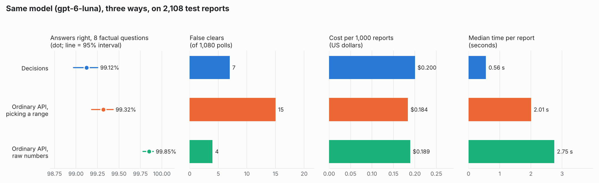
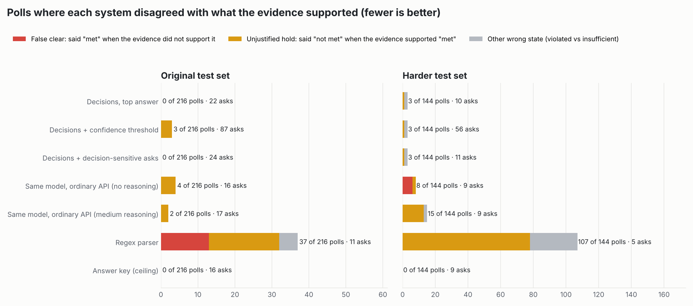
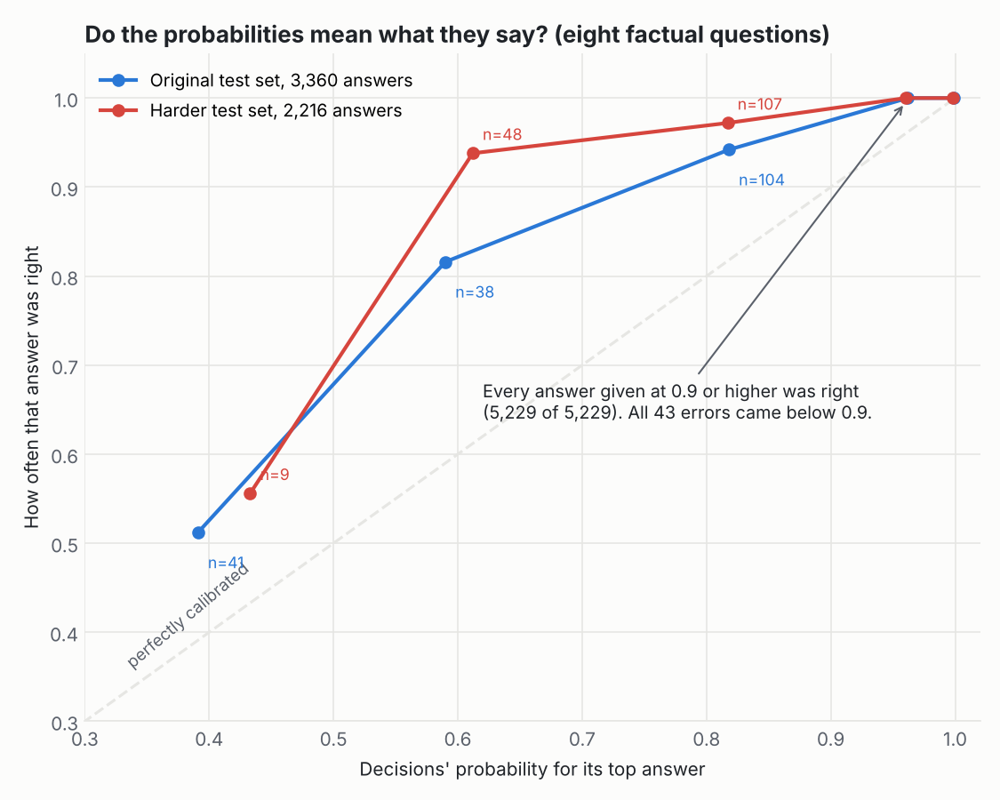

# Launch Window: results, October 12, 2026

A research simulation. A decision model reads the weather voice loop during a modeled launch countdown, and code
applies a small, simplified subset of NASA's published Artemis I weather criteria (LAUNCH_PROTOCOL.md). **"Criteria
met" here never means a launch would be authorized.** Pre-registered at commit `089c5e4` before any report text
existed; every later change is logged in LAUNCH_PROTOCOL.md §8.

> **Final numbers (2,108 test reports, same model three ways).**
> Decisions: 99.12% of factual answers right, $0.200 per 1,000 reports, 0.56 s per report.
> Ordinary API picking a range: 99.32%, $0.184, 2.0 s.
> Ordinary API giving raw numbers that code sorts into ranges: **99.85%**, $0.189, 2.75 s.
> The raw-numbers version was the most accurate and made the fewest false clears (4 of 1,080 polls, against 7 for
> Decisions and 15 for range-picking). Decisions was 4 to 5 times faster, but the least accurate and slightly the most
> expensive. An earlier version of this page, based on the first 697 reports, said Decisions made no false clears and
> that the same model was unsafe through the ordinary API; neither held up. See [Final numbers](#final-numbers-2108-test-reports).

## Final numbers (2,108 test reports)

Registered before any of its texts existed (LAUNCH_PROTOCOL.md §8, change 9): 80 new scenarios (40 original-style,
40 harder), 1,411 new reports written by eight new blind authors and checked by eight new blind reviewers, who agreed
with the answer key on all 12,699 answers. Each system ran once, unchanged from the earlier runs. With the earlier
test sets that makes 2,108 reports and 16,864 factual answers per system.



Video: [one of the 120 scenarios replayed, then the final numbers](docs/launch-window.mp4) (74 s, captions in the
matching .srt).

| | Decisions | Ordinary API, picking a range | Ordinary API, raw numbers |
|---|---:|---:|---:|
| **Answers right, 8 factual questions** (95% interval) | 99.12% (98.97–99.25) | 99.32% (99.18–99.43) | **99.85%** (99.78–99.90) |
| Wrong factual answers | 148 of 16,864 | 115 | 25 |
| Reports with every factual answer right | 93.5% | 94.8% | 98.9% |
| Answers right, all 9 questions | 93.7%\* | 99.2% | 99.6% |
| **False clears** | 7 of 1,080 polls | 15 | **4** |
| Wrong polls | 18 of 1,080 | 41 | 12 |
| **Cost per 1,000 reports** | $0.200 | **$0.184** | $0.189 |
| Tokens per report | 2,002 in, 0 out | 1,483 in, 71 out | 1,133 in, 151 out |
| **Median time per report** | **0.56 s** | 2.01 s | 2.75 s |

\*One harmless quirk: Decisions often answers "unclear" to "does this report correct an earlier one?" for ordinary
reports. The rules treat that as "no", so it changes no decision.

**The 1,411 new reports alone** (the confirmatory result): 99.07% (98.88–99.23), 99.35% (99.19–99.49) and 99.84%
(99.75–99.90); false clears 7, 9 and 4 of 720 polls; wrong polls 15, 29 and 9. Every pair differs significantly on
the same answers (exact McNemar test, Holm-corrected): Decisions vs range-picking p = 0.015, Decisions vs raw numbers
p < 10⁻¹⁶, range-picking vs raw numbers p < 10⁻⁹.

Per question, all 2,108 reports:

| | Obs. time | Wind | Temp 132.5 ft | Temp 257.5 ft | Precip | Lightning | Field mill | Solar |
|---|---:|---:|---:|---:|---:|---:|---:|---:|
| Decisions | 97.9% | 98.5% | 99.5% | 99.4% | 100% | 98.6% | 99.4% | 99.7% |
| Ordinary API, picking a range | 99.2% | 99.6% | 99.6% | 99.2% | 100% | 98.2% | 99.9% | 98.7% |
| Ordinary API, raw numbers | 100% | 99.7% | 99.95% | 99.95% | 100% | 99.2% | 100% | 100% |

**What the new reports showed.**

- **Decisions is not free of false clears.** It made 7, in 4 of the 80 new scenarios. Two came from strike times given
  as clock times ("most recent strike within 10 nm ... at 1350Z"): it placed the strike too far back, so the 30-minute
  lightning wait ended early. Three came from reading "ninety-four point niner degrees" and "94.8" as 94.5 °F or less,
  and two from reading "three-four knots" (radio style for 34) as 25 knots or less.
- **The raw-numbers version's 4 false clears were all that one wind phrase.** Winds of 32 to 34 knots spoken
  digit by digit ("three-four knots", "three-two knots") appeared in 6 reports; raw numbers misread 4 of them,
  range-picking 3 and Decisions 1. Range-picking's 9 also included the familiar heat
  errors (94.9 to 95.3 °F read as "90.0 to 94.5") and lightning time arithmetic.
- **The probability alarm mostly held.** On the new reports, 10,512 of 10,518 answers Decisions gave at 0.9 or higher
  were right. Five of the 6 exceptions were "not mentioned" for temperatures stated without the word "temperature"
  ("87.5 degrees at 132.5 feet"). Over all 2,108 reports: 15,741 of 15,747 (99.96%), and 142 of its 148 errors came
  below 0.9. The ordinary API gave no comparable per-answer probability.
- **Cost was close.** Decisions bills only input tokens, but its requests carry every question and option as input
  (about 2,000 tokens per report against 1,100 to 1,500), so it cost 6 to 9% more per report.

**Which to use, on this evidence.** For accuracy, the ordinary API writing raw values with code doing the sorting.
For speed, Decisions (about 0.6 s against 2 to 3 s), with probabilities that flag most of its errors. Asking the
ordinary API to pick a range was the weakest on safety. All three cost about $0.20 per 1,000 reports.



## What was tested

- **Rules (code).** Peak wind at 132.5 ft, a 30-minute heat streak at two tower levels, precipitation, a 30-minute
  wait after lightning within 10 nmi, a 15-minute wait after a field mill reading of 1,500 V/m, and NOAA S/R level
  4 or 5. A separate agent re-implemented these rules from the protocol text alone; after one bug fix and two
  written clarifications the two engines agree on all 18,592 test cases.
- **Reports (people-like text).** 2,108 test reports in 120 scenarios. First, 697 reports in 40 scenarios: 24 in the
  original test set and 16 in a harder set added after development runs showed every model reading the original set
  almost perfectly. Then 1,411 reports in 80 new scenarios (40 of each style) for the final numbers. Fifteen separate
  author agents wrote the texts without seeing answers, code or results. Blind reviewers answered every question from
  the text alone and agreed with the answer key on all 20,853 answers (2,317 test and development reports), after the
  first review caught a key bug in 15 correction reports.
- **The model's job.** Nine multiple-choice questions per report: when the observations were made, six weather
  readings, and whether it corrects an earlier report. It never compares a value with a limit or adds times.
- **Scoring.** At each of 9 polls per scenario, a system's state is compared with the *justified* state: what the
  evidence it actually received supports. A system that says "met" when the evidence does not support it has made a
  **false clear**, even if the hidden weather happened to be fine. Lucky guesses are not credited.

## Results on the first test sets (697 reports)

All model rows are the same model, gpt-6-luna. "Picking a range" means the model chose one of the same options
Decisions saw; "raw numbers" means it wrote the values it read and code sorted them into those options.

**Original test set** (24 scenarios, 216 polls, 420 reports)

| System | False clears | Unjustified holds | Wrong polls | Clarifications | Answers right (8 factual questions) | Median time per report |
|---|---:|---:|---:|---:|---:|---:|
| Decisions, top answer | 0 | 0 | 0 | 22 | 99.0% | **0.61 s** |
| Decisions + confidence threshold (tuned: 0.6) | 0 | 3 | 3 | 87 | 99.0% | 0.61 s |
| Decisions + decision-sensitive asks (tuned: 0.5) | 0 | 0 | 0 | 24 | 99.0% | 0.61 s |
| Ordinary API, picking a range, reasoning off | 0 | 4 | 4 | 16 | 99.3% | 1.89 s |
| Ordinary API, picking a range, medium reasoning (exploratory) | 0 | 2 | 2 | 17 | 99.9% | 2.65 s |
| Ordinary API, raw numbers, reasoning off (post-hoc) | 0 | 2 | 2 | 17 | 99.9% | 2.85 s |
| Regex parser (frozen before any report existed) | 13 | 19 | 37 | 11 | 96.8% | – |

**Harder test set** (16 scenarios, 144 polls, 277 reports)

| System | False clears | Unjustified holds | Wrong polls | Clarifications | Answers right (8 factual questions) | Median time per report |
|---|---:|---:|---:|---:|---:|---:|
| Decisions, top answer | 0 | 1 | 3 | 10 | 99.5% | **0.58 s** |
| Decisions + confidence threshold | 0 | 1 | 3 | 56 | 99.5% | 0.58 s |
| Decisions + decision-sensitive asks | 0 | 1 | 3 | 11 | 99.5% | 0.58 s |
| Ordinary API, picking a range, reasoning off | **6** (3 scenarios) | 2 | 8 | 9 | 99.1% | 2.03 s |
| Ordinary API, picking a range, medium reasoning (exploratory) | 0 | 13 | 15 | 9 | 98.6% | 3.09 s |
| Ordinary API, raw numbers, reasoning off (post-hoc) | 0 | 1 | 1 | 11 | 99.8% | 2.78 s |
| Regex parser | 0 | 78 | 107 | 5 | 75.1% | – |

The answer-key system (correct answers through the same code) made no errors on either set, which confirms that
every error above is a reading error. Times were measured with up to six requests in flight at once. The raw-numbers
row was designed after the results above it were known (LAUNCH_PROTOCOL.md §8, change 8); read it as a check, not a
pre-registered result.

## What the first test sets showed

**1. On the first test sets, Decisions read the loop reliably, and its mistakes did not change decisions.** It made 33 reading errors on
the original set and 10 on the harder set, but only 3 polls went wrong, all of them cautious ("insufficient" instead
of "met" or "violated"). Most of its errors could not matter: reading "24G31KT" as 36 knots or more is still a wind
violation. It handled the harder set's distractors well: every factual answer right on 145 of 147 reports that
quoted a far-away lightning strike, 83 of 83 that mentioned a G-scale geomagnetic storm, 31 of 31 that gave the wind
direction first, and 38 of 39 where the speaker misspoke and corrected themselves. The raw-numbers variant made
fewer reading errors overall (3 and 4), so Decisions was not the most accurate reader.

**2. Through the ordinary API, picking a range was the weak point, not the model.** Picking from the same ranges,
with reasoning off, the same model made 6 false clears on the harder set, all on the heat rule: it read clearly
stated temperatures such as "95.7 °F" and "ninety-five point three degrees" as "90.0 to 94.5". It also read minor
and moderate solar storms ("S1", "S2") as level 3 in 8 reports. With medium reasoning it made no false clears but
13 unjustified holds, mostly from one over-literal reading: "no lightning within 10 nm in the last 30 minutes,
though a strike 19 nm out" taken as "lightning mentioned only beyond 10 nm" (all 30 of its lightning errors). Asked
for the raw numbers instead, with reasoning off, it made no false clears and the fewest wrong polls on the harder
set (see Follow-ups). Decisions got the ranges right without that change.

**3. The pre-registered hypothesis could not be tested.** H1 predicted that asking for clarification where
Decisions' probabilities said the answer could change the decision would cut false clears. Decisions' top answer
made **no** false clears on either test set, so there was nothing to cut (sign tests: 0 scenarios better, 0 worse,
all tied). The decision-sensitive strategy asked about as often as the top answer (24 vs 22; 11 vs 10) and matched it.

**4. The probabilities are a reliable alarm.** On the eight factual questions, every answer Decisions gave at 0.9 or
higher was right: 5,229 of 5,229. All 43 of its factual errors came with a top probability below 0.9. Below 0.9 it
is underconfident: answers at 0.5 to 0.7 were right 82% (original) and 94% (harder) of the time. The ordinary API
gave no comparable per-answer probability. On the 1,411 new reports the alarm missed 6 confident errors (see Final
numbers).



**5. Asking whenever confidence is low backfires.** The threshold strategy spent most of its asks on questions that
could not change anything: 45 of 87 (original) and 38 of 56 (harder) were about whether a report was a correction,
where Decisions has a quirk (it often puts 60 to 85% on "unclear" for ordinary reports, which the rules treat as
"no"). With 4 asks per countdown, it had none left by the time the window opened in two scenarios; when genuinely unclear wind
reports then arrived, it could not ask, and it held when the evidence could have cleared. Spending clarifications only
where the answer could change the decision avoided that.

**6. Corrections over time.** The model systems recognized changes in the justified state at the next poll (median
delay 0 minutes); Decisions missed 1 change on the harder set, medium reasoning 5. Reports that correct an earlier value, stale relays and conflicting sources were handled by the
protocol code once the observation time and correction flag were read correctly; Decisions read the factual content
of correction reports right in 14 of 17 and stale relays in 51 of 52. The regex parser never recognized 12 changes on
the original set and 33 on the harder set.

**7. Batching: no interference at all.** Every test report was also asked one question per request (6,273 requests).
On all 697 reports, the answer to every one of the 9 questions was identical either way (100% agreement), so accuracy
was identical too. Asking all 9 at once used 9 times fewer requests and 29 to 36% fewer input tokens (1.34 million
against 1.97 million), and took 0.6 s per report against about 5 s for nine sequential requests.

## Follow-ups: endpoint or answer format?

Two checks run after the results above, both logged before they ran (LAUNCH_PROTOCOL.md §8, change 8).

**Raw numbers instead of ranges.** The same model through the ordinary API, reasoning off, wrote what it read (for
example "95.7" for the 132.5 ft temperature, "+1800 V/m" for a field mill, a strike time as a clock time) into a
strict JSON schema, and code converted units, did the time arithmetic and sorted each value into the answer key's own ranges. It made no false
clears on either test set. Its reading errors fell from 23 to 3 on the original set and from 19 to 4 on the harder
set (eight factual questions), with no temperature error at all. It was not built blind: its schema was written
after seeing where range-picking failed.

**Three independent runs on the harder set** (fresh requests, nothing cached):

| System | False clears, runs 1 / 2 / 3 | Wrong polls | Answers that changed from run 1 (of 2,493) |
|---|---|---|---|
| Decisions, top answer | 0 / 0 / 0 | 3 / 3 / 3 | 0 and 0 |
| Ordinary API, picking a range | 6 / 7 / 6 | 8 / 13 / 13 | 22 and 21 |
| Ordinary API, raw numbers | 0 / 0 / 0 | 1 / 1 / 1 | 23 and 13 |

The range-picking false clears were not a fluke: every run had them, always in the same 3 scenarios and always on
the heat rule. Decisions returned exactly the same answers and poll states every time. The ordinary API changed up to about 1
answer in 100 between runs, which moved 10 (ranges) and 4 (raw numbers) of 288 poll states; with raw numbers each
run still had just 1 wrong poll.

**What this changes.** "The same model is safer through Decisions" does not hold. Decisions was safe with ranges,
and the ordinary API was safe once code did the sorting. What Decisions still offered here: answers in about 0.6 s
against 2.6 to 2.9 s, identical answers on every run, and probabilities that put every factual error below 0.9 (on the new reports, 99
of 105). The cost was
about the same ($0.056 against $0.053 for one pass over the harder set).

## Diagnostics

- **Evidence vs reality.** Even with perfect reading, the evidence sometimes could not support the true state: on
  the original set the justified state was "insufficient" in 30 polls where the hidden weather was in fact acceptable
  (23) or violated (7), mostly because reports were stale, vague or conflicting. That is the cost of the protocol's
  caution, not of any model, and it is why scoring against the hidden truth would reward guessing: the range-picking
  ordinary API "used" more launch chances than the answer key on the harder set (85 vs 82) by clearing on evidence
  that did not support it.
- **Why the regex parser matters.** It shows the text is not trivially parsable: 13 false clears on the original set,
  and on the harder set it could not read the distractor phrasings at all (75% of answers right, no launch chance used).

## Limits

- **A simulation.** A small, simplified subset of NASA's published criteria (the full rules include cloud,
  anvil and field-mill caveats this does not model). Nothing here says anything about real launch decisions.
- **AI-written reports.** Authors and reviewers were AI agents, not meteorologists or launch weather officers. The
  "vague range" trap always used a range around the limit (for example "27 to 32 knots"), sometimes far from the
  true value, which a real speaker would not do.
- **Small numbers for safety.** Accuracy rests on 16,864 answers per system, but false clears are rare events (4 to
  15 per system over 1,080 polls, from 3 to 9 scenarios), so their differences are less certain than the accuracy
  differences. Each system ran once on the new reports; only the first harder set was repeated.
- **Prompt format.** As the follow-ups show, the answer format changed the result more than the endpoint did. Other
  formats were not tried. The raw-numbers schema was designed after seeing the first failures, then frozen before the
  1,411 new reports existed.
- **Latency** was measured with up to six requests in parallel and includes queuing at the API.
- **The harder set was added after development runs** (logged as change 6, before any test request), because the
  original set left the probabilities nothing to fix.

## Cost

About $2.06 for this experiment, counted conservatively: $0.79 for the pre-registered development and test runs,
clarifications, tuning grid and batching comparison, $0.45 for the follow-ups, and $0.81 for the three systems on the
1,411 new reports. Decisions bills only input tokens ($0.10 per million); the ordinary-API runs also paid for about
750,000 output tokens ($0.50 per million). Earlier experiments, since removed from this repository (they remain in its git history), bring the
account's total to about $2.42 of a $4 cap.

## Reproduce

```bash
python -m defuse.launch run --split test           # and --split hard_test
python -m defuse.launch run --split hard_test --systems responses-luna-none-raw   # follow-up; --repeat 2 for repeats
python -m defuse.launch report --split test
python -m defuse.launch batching --split test
python -m defuse.launch.followups
python -m defuse.launch run --split confirm --systems decisions-top responses-luna-none responses-luna-none-raw   # and hard_confirm
python -m defuse.launch.confirm                    # final numbers (data/launch/confirm.json)
python -m defuse.launch.charts data/launch
```
